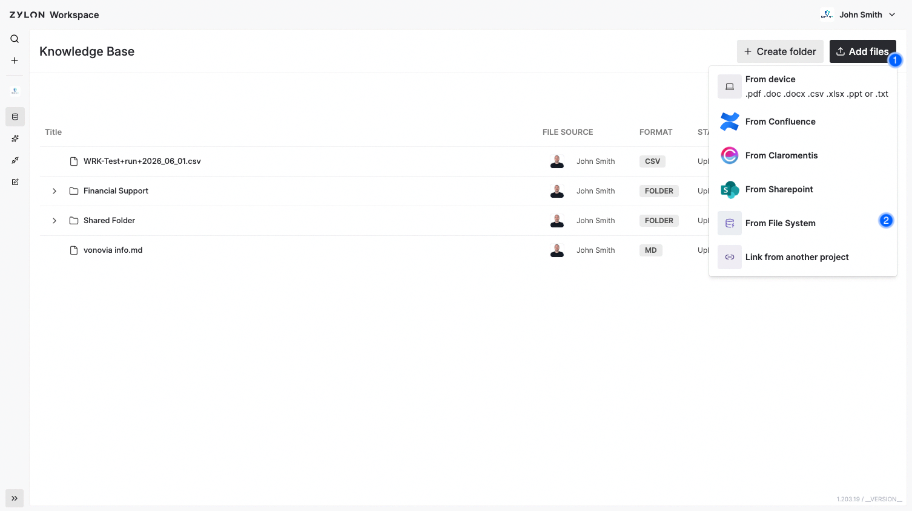

Use **File System** to import files and folders from the Samba/SMB share configured for your Zylon installation.

## Before connecting

Your operator must [enable and configure the connector](/en/v1.58/operator-manual/knowledge-base/file-system). They configure the server, port, and exported share; you do not enter a server address or folder path in the login form.

**Only SMB2 is supported.** Ask your operator to confirm that the server allows SMB2; SMB1 and SMB3 connections are not supported. See the [protocol and security requirements](/en/v1.58/operator-manual/knowledge-base/file-system#protocol-and-security-compatibility).

You need a Samba account that can list the folders and read the files you want to import. **The username can be a local Samba account such as `zylon`; it does not have to be an email address.** Use that account's Samba password, which may differ from your Zylon password.

<Warning>
  Everyone with access to the project can access the files and folders imported into its Knowledge Base, independently of the original SMB permissions. Select content appropriate for the project's members.
</Warning>

## Import files or folders

1. Open the project's **Knowledge Base** and choose **Add files → From File System**.
2. If a connection is required, enter your Samba **Username** and **Password** and choose **Log in**. If a suitable connector already exists, select it to open its folder picker.
3. Browse the configured share. Expand folders to find the content you need, select the files or folders, and choose **Upload**.
4. Wait for processing to finish and confirm that the content appears in the Knowledge Base.

For example, if the share is `zylon-samba` and the folder is `Departments/HR policies`, open `Departments` and select `HR policies` in the picker. The operator's `external.samba.name` remains `zylon-samba`; a subfolder is not a different share.

## If you cannot connect or find a folder

- **Invalid user or password:** check the Samba credentials. The same message can also indicate a server connection or compatibility problem, so ask your operator to check the [connection troubleshooting guide](/en/v1.58/operator-manual/knowledge-base/file-system#troubleshooting) if the account is known to work.
- **Folder missing or empty:** check that you are browsing the correct share and that the Samba account can list every parent folder and read the required files. Hidden entries are excluded. Ask the operator to investigate listing errors if the folder still appears empty.
- **Access works in another client:** this does not guarantee access from Zylon's backend or support for the server's encryption/authentication requirements. Share the error and time of the attempt with your operator, never the password.

After the operator resolves the connection problem, cancel and reopen the File System flow and retry. Check the Knowledge Base before repeating an upload so you can identify content already imported.

## Update imported content

After importing, use **Update** in the item's three-dot menu to sync with the source:

- Detect content changes in files.
- Add new files and remove deleted ones.
- Reflect moves and renames in the folder structure.

Updates use the connector's stored Samba credentials. Your operator can also configure [scheduled synchronization](/en/v1.58/operator-manual/configuration/cron-tasks/sync).
