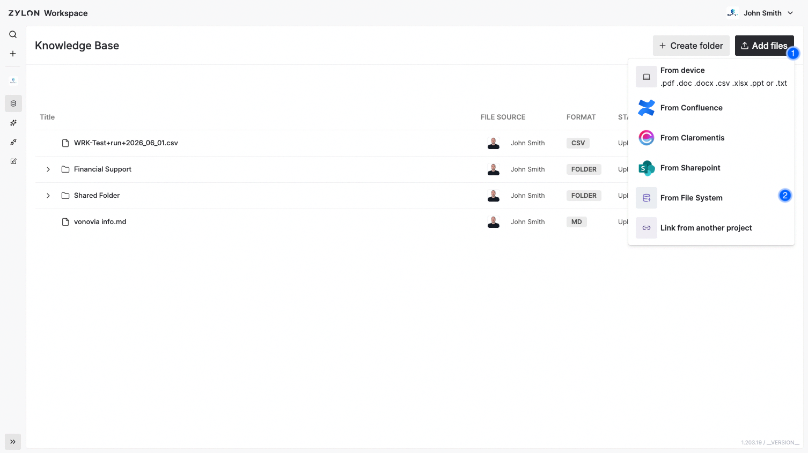

Utiliza **Sistema de archivos** para importar archivos y carpetas del recurso Samba/SMB configurado para tu instalación de Zylon.

## Antes de conectar

El operador debe [habilitar y configurar el conector](/es/v1.58/operator-manual/knowledge-base/file-system). Configura el servidor, el puerto y el recurso compartido exportado; no introduces una dirección de servidor ni una ruta de carpeta en el formulario de acceso.

**Solo se admite SMB2.** Pide al operador que confirme que el servidor permite SMB2; las conexiones SMB1 y SMB3 no están soportadas. Consulta los [requisitos de protocolo y seguridad](/es/v1.58/operator-manual/knowledge-base/file-system#compatibilidad-de-protocolo-y-seguridad).

Necesitas una cuenta Samba que pueda listar las carpetas y leer los archivos que quieres importar. **El usuario puede ser una cuenta Samba local como `zylon`; no tiene que ser un correo electrónico.** Utiliza la contraseña Samba de esa cuenta, que puede ser distinta de tu contraseña de Zylon.

<Warning>
  Todos los usuarios con acceso al proyecto pueden acceder a los archivos y carpetas importados en su Base de conocimiento, independientemente de los permisos SMB originales. Selecciona contenido adecuado para los miembros del proyecto.
</Warning>

## Importa archivos o carpetas

1. Abre la **Base de conocimiento** del proyecto y elige **Añadir archivos → Desde el Sistema de Archivos** (**Add files → From File System** en la interfaz en inglés).
2. Si necesitas conectar, introduce el **Usuario** y la **Contraseña** de Samba y pulsa **Inicia Sesión** (**Log in**). Si ya existe un conector adecuado, selecciónalo para abrir su explorador de carpetas.
3. Explora el recurso compartido configurado. Despliega las carpetas hasta encontrar el contenido, selecciona los archivos o carpetas y pulsa **Subir** (**Upload**).
4. Espera a que termine el procesamiento y confirma que el contenido aparece en la Base de conocimiento.

Por ejemplo, si el recurso compartido es `zylon-samba` y la carpeta es `Departments/HR policies`, abre `Departments` y selecciona `HR policies` en el explorador. El parámetro `external.samba.name` del operador sigue siendo `zylon-samba`; una subcarpeta no es otro recurso compartido.

## Si no puedes conectar o encontrar una carpeta

- **Usuario o contraseña inválidos:** comprueba las credenciales Samba. El mismo mensaje puede indicar un problema de conexión o compatibilidad del servidor. Si sabes que la cuenta funciona, pide al operador que siga la [guía de solución de problemas de conexión](/es/v1.58/operator-manual/knowledge-base/file-system#soluci%C3%B3n-de-problemas).
- **La carpeta no aparece o está vacía:** comprueba que estás en el recurso correcto y que la cuenta Samba puede listar todas las carpetas padre y leer los archivos necesarios. Las entradas ocultas se excluyen. Si sigue vacía, pide al operador que investigue los errores de listado.
- **El acceso funciona con otro cliente:** no garantiza acceso desde el backend de Zylon ni compatibilidad con los requisitos de cifrado o autenticación del servidor. Indica al operador el error y la hora del intento, nunca la contraseña.

Cuando el operador resuelva el problema de conexión, cancela y vuelve a abrir el flujo de Sistema de archivos para reintentar. Revisa la Base de conocimiento antes de repetir una subida para identificar el contenido que ya se haya importado.

## Actualiza el contenido importado

Después de importar, utiliza **Actualizar** (**Update**) en el menú de tres puntos del elemento para sincronizar con el origen:

- Detecta cambios en el contenido de los archivos.
- Añade archivos nuevos y elimina los borrados.
- Refleja movimientos y cambios de nombre en la estructura de carpetas.

Las actualizaciones utilizan las credenciales Samba guardadas en el conector. El operador también puede configurar la [sincronización programada](/es/v1.58/operator-manual/configuration/cron-tasks/sync).
