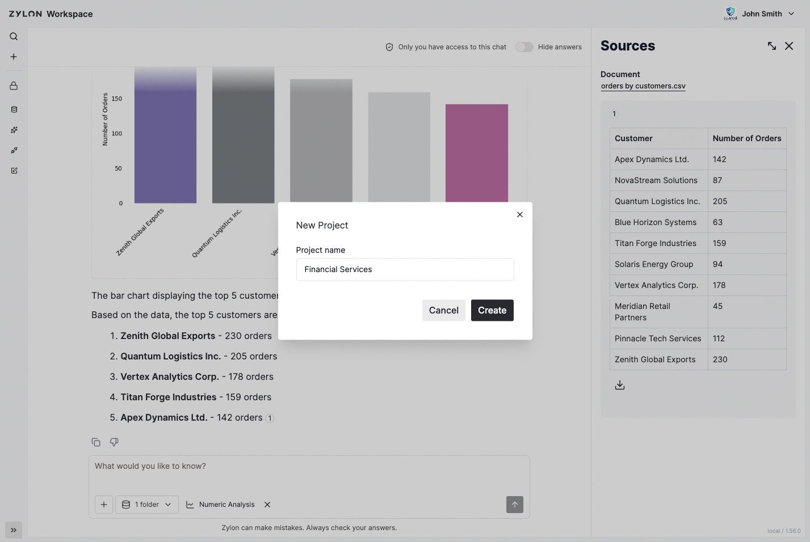
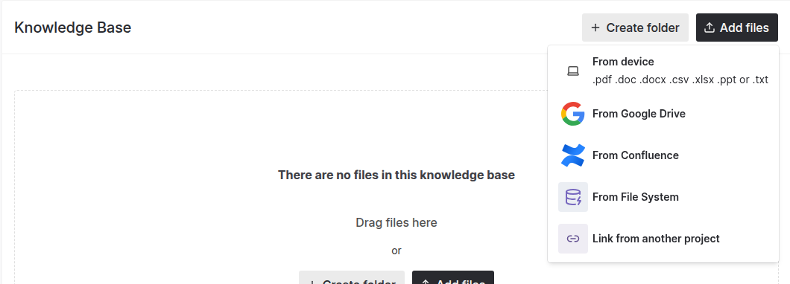
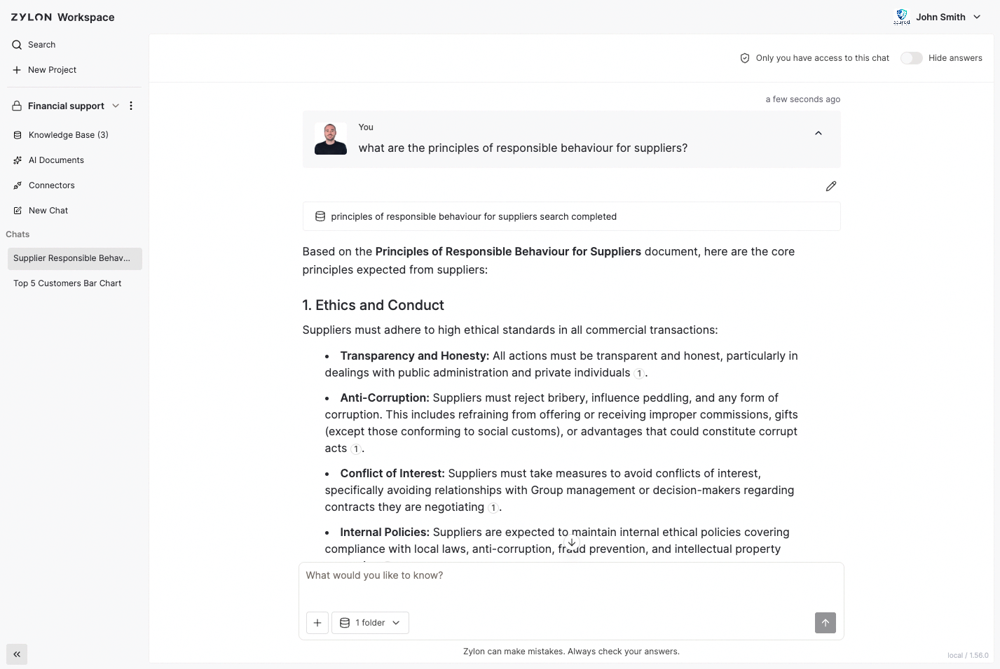
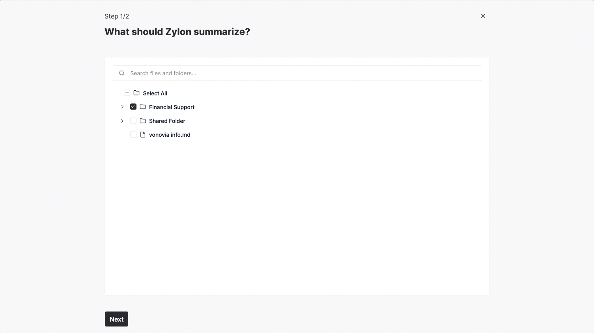

Completa estas tareas esenciales para empezar a usar Zylon de forma efectiva. Esta guía tarda unos 15 minutos y cubre todo lo que necesitas para ser productivo.

## Paso 1: Crea tu primer proyecto (3 minutos)

Los proyectos organizan tu trabajo de IA por tema o equipo. Empieza con un proyecto personal sencillo.

1. **Haz clic en "New Project"** en la barra lateral (nuevo proyecto en la interfaz en inglés)
2. **Nómbralo de forma descriptiva** - p. ej., "Investigación personal" o "Atención al cliente"
3. **Mantenlo privado** por ahora (puedes compartirlo más tarde)



<Info>
Los proyectos son privados por defecto. Solo tú puedes verlos a menos que los compartas explícitamente con otros.
</Info>

## Paso 2: Conecta tu conocimiento (5 minutos)

Añade documentos para que Zylon pueda ayudarte con tu trabajo real. Navega a la sección de Base de conocimiento de tu proyecto.

**Opción A: Subir archivos**
1. **Arrastra y suelta** 2-3 documentos con los que trabajas regularmente
2. **Espera el procesamiento** (normalmente 2-5 minutos)
3. **Comprueba la base de conocimiento** para confirmar que están listos

**Opción B: Conectarte a una fuente externa, como SharePoint**
1. En la base de conocimiento, abre **Add files** y elige una fuente disponible.
2. Si SharePoint está disponible, sigue las indicaciones para autenticarte y seleccionar una carpeta a la que tengas acceso.

SharePoint requiere la configuración de un administrador y puede no aparecer en todas las instalaciones. Si no está disponible, consulta a tu administrador o sube archivos desde tu dispositivo. Para más información, consulta la [guía del conector de SharePoint](/es/v1.58/user-manual/connectors/sharepoint).



**Tipos de archivo admitidos:**
- PDFs, documentos de Word, hojas de cálculo de Excel
- Presentaciones de PowerPoint, archivos de texto plano
- Carpetas de SharePoint, espacios de Confluence, FTP/Samba

## Paso 3: Haz tu primera pregunta (3 minutos)

Ahora prueba Zylon con una pregunta real sobre tus documentos.

1. **Inicia un nuevo chat** (elige Personal por ahora)
2. **Haz una pregunta específica** sobre los documentos que subiste
3. **Revisa la respuesta** y haz clic en las citas
4. **Haz una pregunta de seguimiento** para ver cómo Zylon mantiene el contexto

**Buenos ejemplos de preguntas:**
```
"¿Cuáles son los requisitos clave mencionados en [nombre del documento]?"
"¿Cuál es nuestra política sobre [tema específico]?"
```



## Paso 4: Prueba un Documento IA (4 minutos)

Los documentos IA gestionan tareas complejas automáticamente en segundo plano.

1. **Ve a Documentos IA** en tu proyecto
2. **Elige "Resumir un archivo"**
3. **Selecciona uno de tus documentos subidos**
4. **Añade instrucciones** como "Crea un resumen ejecutivo centrado en decisiones clave"
5. **Haz clic en Iniciar** y déjalo ejecutarse en segundo plano



**Otros documentos IA para probar:**
- **Responder en masa**: Sube una lista de preguntas para respuestas automáticas
- **Generar un borrador**: Crea nuevos documentos a partir de indicaciones
- **Leer y extraer**: Extrae información específica de múltiples documentos

## Lo que has conseguido

✅ **Creado y organizado** tu primer proyecto  
✅ **Conectado fuentes de conocimiento** para que Zylon pueda ayudar con trabajo real  
✅ **Mantenido conversaciones de IA** con citas y contexto  
✅ **Usado flujos de trabajo automatizados** para tareas documentales complejas  
